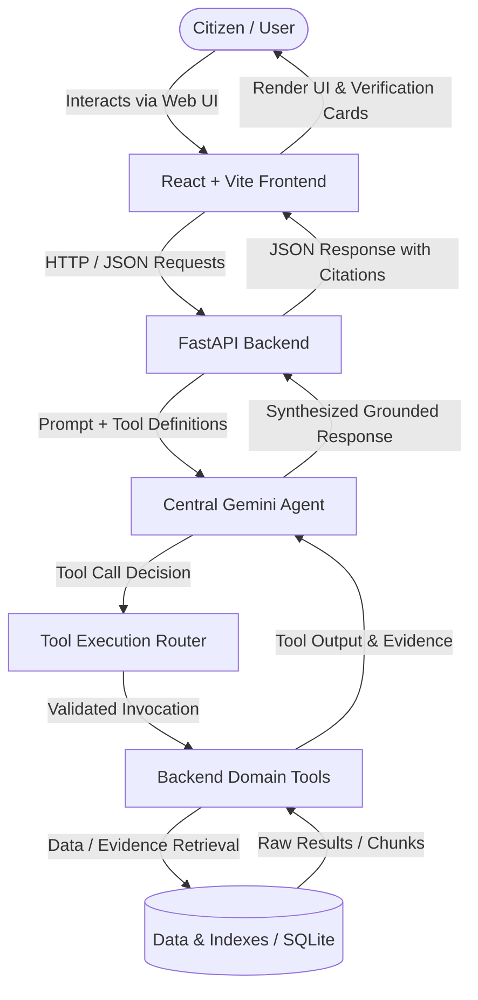
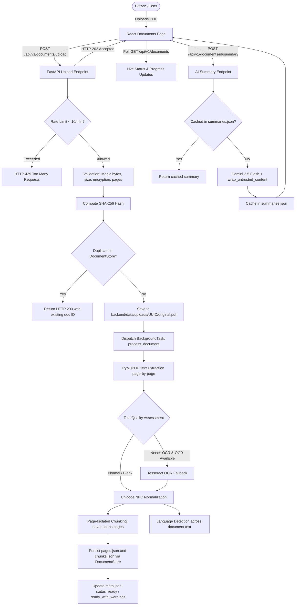
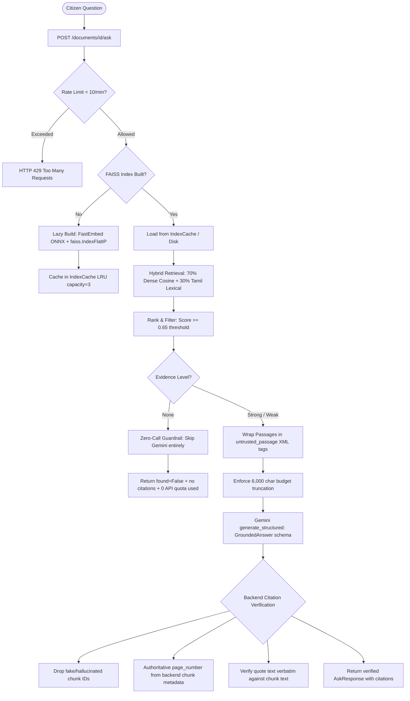
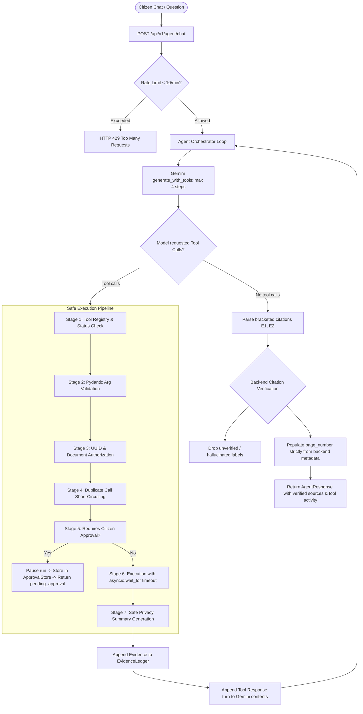
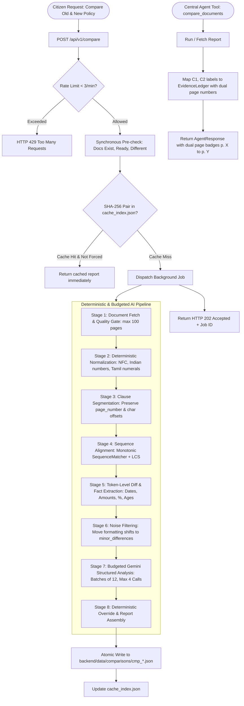
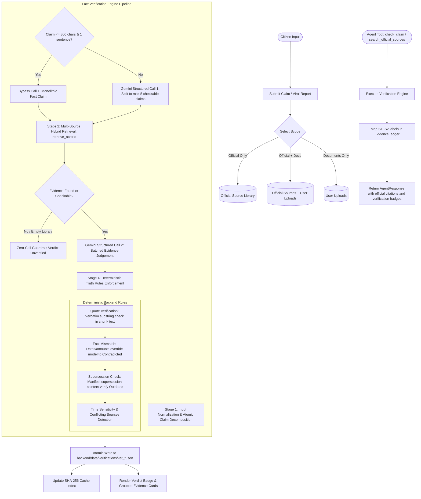
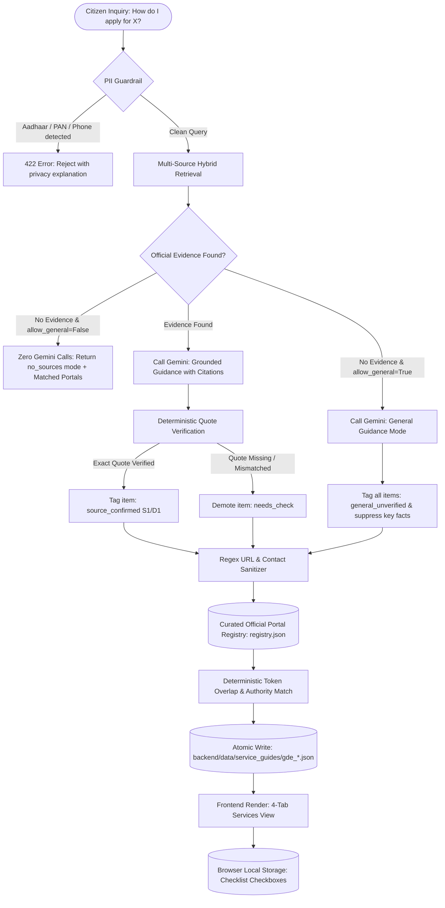
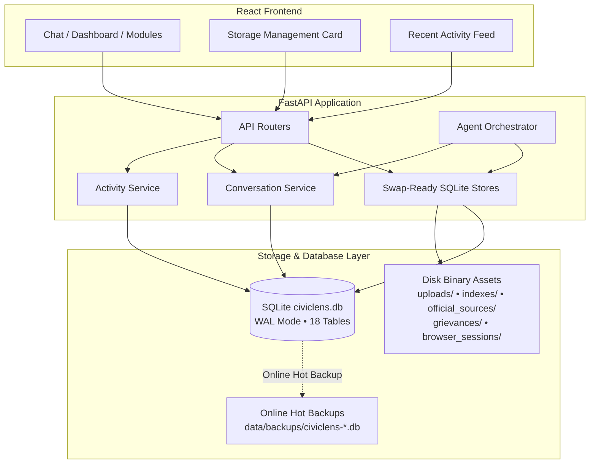
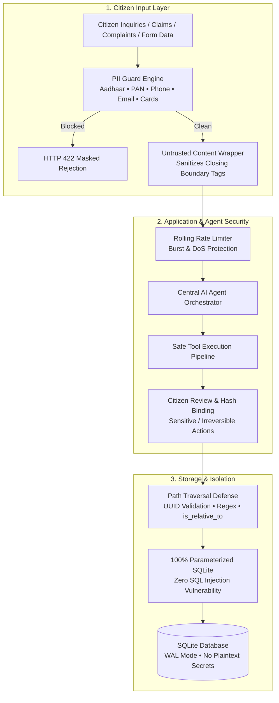

# CivicLens — System Architecture

This document describes the end-to-end design, communication flow, backend tool definitions, design decisions, and frontend structure for CivicLens.

---

## 1. High-Level Communication Flow

The application follows a clean client-server architecture with a single central agent orchestration pattern:



### Flow Breakdown (In Plain Language):
1. **User Request**: The user enters a question or uploads a government PDF using the React frontend.
2. **Frontend Request**: The React frontend sends an HTTP request to the FastAPI backend API. No API keys or secrets live in the frontend.
3. **Agent Activation**: The FastAPI backend routes the inquiry to the **Central Gemini Agent** along with tool declarations.
4. **Tool Selection**: The Gemini agent analyzes the request, decides which specialized tool is needed (or whether it needs multiple tool calls), and outputs structured tool call arguments.
5. **Backend Tool Execution & Validation**: The backend intercepts the tool call, validates all parameters and access permissions, and executes the designated backend function locally.
6. **Evidence Retrieval & Processing**: The tool queries local document indexes, official source repositories, or comparison engines to gather concrete evidence.
7. **Agent Synthesis**: The tool's output is returned to the Gemini Agent, which crafts a final, verified response with direct citations.
8. **Frontend Display**: The backend sends the structured response back to the frontend, displaying plain-language explanations alongside verifiable evidence cards.

---

## 2. Architectural Decision: Central Orchestrator vs. Multi-Agent

### The Decision:
**CivicLens adopts ONE central orchestrating agent equipped with specialized backend tools, rather than a swarm of independent agents.**

### Rationale:
- **Predictability and Control**: A single orchestrating agent maintains a unified conversation history and clear intent without conflicting inter-agent messages.
- **Resource Efficiency**: Multiple autonomous agents running simultaneously consume significant memory and API quota, which conflicts with low-resource hardware constraints (8 GB RAM, Core i3).
- **Security & Validation**: Having the backend act as the intermediary between the central agent and tool execution allows strict validation of every single tool call before running any code.

---

## 3. Planned Backend Tools

The central Gemini agent operates through a curated registry of specialized backend tools:

| Tool Name | Purpose | Input | Expected Output |
| :--- | :--- | :--- | :--- |
| `search_official_sources` | Searches curated repository of official gazettes, laws, and circulars | Search query, jurisdiction, topic | Ranked list of relevant official source excerpts |
| `read_document` | Extracts text and structural sections from an uploaded document | Document ID, page range | Text content with metadata and section headings |
| `retrieve_evidence` | Vector similarity search over chunked document embeddings | Query text, document ID, top_k | Most relevant text chunks with similarity scores |
| `compare_documents` | Analyzes differences between old and new policy documents | Base doc ID, revised doc ID | Structured delta of additions, modifications, and removals |
| `check_claim` | Compares a user-submitted claim against verified records | Claim statement, domain | Verification verdict (Supported / Contradicted / Unverified / Outdated) and citations |
| `generate_checklist` | Produces an actionable checklist for a specific civic procedure | Procedure name, user profile | Step-by-step checklist, required documents, eligibility criteria |
| `draft_complaint` | Drafts a formal grievance letter based on citizen input | Complaint details, department, tone | Formatted complaint draft with formal subject and narrative |
| `open_service_portal` | Launches controlled browser demo for a service workflow | Service identifier, demo URL | Portal session ID and initial view state |
| `fill_demo_form` | Simulates safe autofill in the controlled demo portal | Session ID, field mapping | Step execution confirmation and visual demo output |

---

## 4. Backend Tool Validation & Guardrails

- **Strict Schema Enforcement**: Every tool parameter is validated using Pydantic schemas prior to function execution.
- **Path Traversal Protection**: File operations in `read_document` and `retrieve_evidence` are locked to designated `backend/data/` subdirectories.
- **Read-Only Data Access**: Tools retrieving evidence operate in read-only mode against official records.
- **Sandboxed Demonstrations**: `open_service_portal` and `fill_demo_form` are hardcoded to interact only with local demo portal endpoints, never external networks.

---

## 5. Frontend Architecture & Design System

The frontend is built with React, Vite, and Tailwind CSS, prioritizing performance, accessibility, and offline bilingual support:

### Directory Architecture (`frontend/src/`)
- **`components/ui/`**: Atomic, accessible design system components (`Button`, `Card`, `Badge`, `Input`, `Textarea`, `Select`, `Alert`, `Spinner`, `Skeleton`, `Modal`, `FileDropzone`, `EmptyState`, `ErrorState`, `PageHeader`, `Logo`, `LanguageSwitcher`).
- **`components/dashboard/`**: Dashboard widgets (`RecentActivity`, `RecentDocuments`) that receive data via props and render structured lists or honest `EmptyState` fallbacks.
- **`layouts/`**:
  - `PublicLayout`: Landing page header, navigation links, language switcher, and multi-column civic footer.
  - `AppLayout`: Logged-in application shell featuring a collapsable mobile sidebar drawer, active route indicators, header bar, and main viewport.
- **`context/` & `hooks/`**: Lightweight React Context providers with dedicated custom hooks:
  - `LanguageContext` / `useLanguage`: Instant bilingual switching (English / Tamil) backed by `localStorage` and dynamic `<html lang="...">` updates.
  - `ToastContext` / `useToast`: Accessible notification system supporting `info`, `success`, `warning`, and `error` toasts.
- **`utils/i18n/`**: Key-value translation dictionaries (`en.js`, `ta.js`) covering navigation, page titles, descriptions, buttons, verification verdicts, and messages.
- **`pages/`**: Route components for all 8 application destinations (`/`, `/dashboard`, `/assistant`, `/documents`, `/compare`, `/verify`, `/services`, `/grievance`), a catch-all 404 page (`*`), and a developer visual testbed (`/design-system`).

### Design Tokens & Typography
- **Palette**: Deep civic blue (`#1e3a8a`), teal accent (`#0d9488`), alert amber (`#d97706`), error rose (`#dc2626`), and slate neutrals.
- **Offline Typography**: Pre-packaged fonts via `@fontsource/inter` (Latin) and `@fontsource/noto-sans-tamil` (Tamil) with language-tuned line heights.
- **Accessibility**: High-contrast ratios compliant with WCAG AA, visible `:focus-visible` rings on all interactive elements, and accessible Escape key dismissal on dialogs.

---

## 6. Landing Page & Dashboard Structure

### Landing Page (`/`, PublicLayout)
Organized into seven progressive sections:
1. **Hero**: Brand identity, tagline, plain-language value proposition, primary and secondary CTAs, and a custom inline vector illustration depicting a verified gazette and evidence lens.
2. **The Problem**: 4 concise cards breaking down the citizen dilemma (dense documents, quiet amendments, viral misinformation, confusing procedures).
3. **Five Core Capabilities**: Feature showcase highlighting the five civic intelligence tools with direct links to their application routes.
4. **How It Works**: 5-step visual pipeline illustrating how the central AI agent moves from citizen query to tool selection, evidence verification, and grounded answers.
5. **Evidence, Trust & Safety**: Ground rules on evidence-based grounding, transparent uncertainty (`Unverified` verdict), data sanitization, human-in-the-loop approvals, and a clear demo disclaimer.
6. **Bilingual Support**: Native English and Tamil language capabilities featuring side-by-side sample inquiries.
7. **Final Call to Action**: Direct invitation to enter the application dashboard.

### Dashboard (`/dashboard`, AppLayout)
A productivity-focused civic intelligence hub:
1. **Welcome Header**: Warm, neutral greeting with dynamic page description and language selector.
2. **AI Assistant Shortcut Card**: High-contrast hero widget highlighting the central Gemini agent, equipped with 4 prompt suggestion chips that navigate to `/assistant` while prefilling query parameters (`?q=...`) and router state.
3. **Quick Actions**: One-click shortcuts for primary tasks (Upload PDF, Compare Notifications, Check Claim, Prepare Grievance).
4. **Modules Grid**: Interactive overview of the five core modules.
5. **Activity & Document Feeds**: `RecentActivity` and `RecentDocuments` widgets that gracefully present honest empty states until real persistence is introduced in Phase 15.

---

## 7. Backend Architecture & API Standards

The backend is powered by FastAPI and Pydantic v2, designed to run with minimal CPU and memory overhead:

### Directory Architecture (`backend/app/`)
- **`main.py`**: FastAPI entrypoint with lifespan event logging, CORS middleware, X-Request-ID propagation middleware, and centralized exception handlers.
- **`core/`**:
  - `config.py`: Environment configuration via `pydantic-settings` (`Settings` class loading `.env`). Exposes safe properties (`is_gemini_configured`, `cors_origins_list`) without leaking raw secrets.
  - `logging.py`: Structured console logging with configurable log levels by environment (`development`, `testing`, `production`).
  - `errors.py`: Global exception handlers mapping `RequestValidationError`, `HTTPException`, and unhandled errors into a uniform JSON response envelope.
- **`models/`**:
  - `common.py`: Pydantic models for health (`HealthResponse`), system info (`InfoResponse`, `ModuleInfo`), and standard errors (`ErrorResponse`, `ErrorDetail`).
- **`api/`**:
  - `health.py`: Endpoints for `GET /api/v1/health` and `GET /api/v1/info`.
  - `router.py`: Central router aggregating domain routes under the `/api/v1` prefix.

### Standard Error Envelope Format
All error responses returned by the backend adhere strictly to this uniform structure:
```json
{
  "error": {
    "code": "NOT_FOUND",
    "message": "The requested civic resource was not found",
    "details": null
  }
}
```

### Request ID & Traceability
Every incoming HTTP request is assigned a unique `X-Request-ID` (UUID4). This header is propagated in response headers and logged with process duration in milliseconds (`X-Process-Time`).

---

## 8. Frontend-Backend Connectivity & Resilience

- **Native Fetch Client (`apiClient.js`)**: Lightweight wrapper around `window.fetch` with built-in timeout abort handling (`AbortController`, default 15s) and typed `ApiError` mapping.
- **Reactive Status Polling (`useBackendStatus.js`)**: Background hook polling `/api/v1/health` and `/api/v1/info` every 30 seconds.
- **Graceful Degradation**: If the backend is offline or unreachable, the frontend continues to render smoothly with honest warning indicators (`BackendStatus.jsx` badge and `SystemStatusCard.jsx` on `/dashboard`) offering a one-click retry button and exact terminal start instructions without crashing.

---

## 9. Gemini AI Service Layer

The AI capability of CivicLens is centralized in `backend/app/services/gemini_service.py`, powered by the official Google Gen AI Python SDK (`google-genai`). All AI calls originate strictly from the backend; the frontend never interacts directly with Gemini or holds credentials.

### Structure & Architectural Separation
- **`app/services/gemini_service.py`**: Singleton/dependency-injected `GeminiService` class handling client lifecycle, asynchronous API execution via `client.aio`, retry loops with exponential backoff and jitter, and safety evaluations.
- **`app/core/prompts.py`**: Central repository for the base system prompt and boundary isolation helper (`wrap_untrusted_content`). Enforces:
  1. Evidence-based grounding (no hallucinated eligibility, deadlines, or fees).
  2. Prompt injection defense (treating uploaded documents as passive data, never directives).
  3. Strict bilingual parity (English and Tamil).
  4. Non-governmental prototype transparency.
- **`app/api/gemini.py`**:
  - `GET /api/v1/gemini/status`: Zero-quota check returning whether Gemini is configured and the active model.
  - `POST /api/v1/gemini/test`: Lightweight diagnostic test limited to 5 requests per minute via an in-memory rolling window.

### Methods & Future Phase Capabilities
1. `generate_text(prompt_or_messages, system_instruction, ...)`:
   - Supports single prompts or multi-turn conversational histories (`[{"role": "user", ...}, {"role": "model", ...}]`).
   - Powers the bilingual chatbot in **Phase 6**, RAG evidence synthesis in **Phase 8**, and policy delta explanations in **Phase 10**.
2. `generate_structured(prompt, response_model, ...)`:
   - Configures Gemini's native JSON schema output (`response_mime_type="application/json"` and `response_schema=response_model`), parsing and validating results directly into strongly-typed Pydantic schemas.
   - Powers user intent classification in **Phase 6**, 4-way fact verdicts in **Phase 11**, procedural checklists in **Phase 12**, and formal petitions in **Phase 13**.
3. `generate_with_tools(prompt_or_messages, tools, ...)`:
   - Minimal asynchronous skeleton accepting tool declarations and returning structured function calls.
   - Powers the central autonomous agent and tool invocation loop in **Phase 9**.

### Reliability, Rate-Limits & Security Guardrails
- **Exponential Backoff**: Transient 429 (Resource Exhausted) and 5xx errors automatically trigger up to `GEMINI_MAX_RETRIES` (default 2) with randomized backoff delays.
- **Safety Filtering**: Responses terminating with `SAFETY` or `BLOCKED` raise typed `GeminiSafetyBlockedError` mapped to clean HTTP 400 JSON errors.
- **Quota Conservation**: Status polling consumes 0 quota; test endpoint is hard rate-limited.
- **Zero Secret Exposure**: The `GEMINI_API_KEY` is loaded strictly into memory from `backend/.env`. It is never returned in API payloads, logged to console, or tracked by Git. Log statements capture only model names, token counts, latency, and sanitized error categories.

---

## 10. Conversational AI Assistant & Language Processing Flow

Phase 6 implements the central bilingual chatbot, establishing the conversational interface used across the entire application:

```mermaid
flowchart TD
    User([Citizen Input]) --> UI[React Assistant View /useChat]
    UI -->|POST /api/v1/chat| API[Chat Endpoint /api/chat.py]
    API --> RateCheck{Rate Limit < 20/min?}
    RateCheck -->|Exceeded| Err429[HTTP 429 Too Many Requests]
    RateCheck -->|Allowed| ChatSvc[ChatService /chat_service.py]
    ChatSvc --> LangSvc[LanguageService /language_service.py]
    LangSvc -->|Unicode Script Analysis| DetectedLang[Detect: en / ta / mixed]
    DetectedLang --> TargetLang[Resolve Target: en or ta]
    ChatSvc --> Trim[History Trimmer: max 10 turns, 12k chars]
    ChatSvc --> PromptAssembler[Assemble Prompt: Base + Chat Notice + Lang Instruction]
    PromptAssembler --> Gemini[GeminiService: generate_text]
    Gemini --> APIStudio[Google AI Studio: Gemini 2.5 Flash]
    APIStudio --> Gemini
    Gemini --> ChatSvc
    ChatSvc -->|ChatResponse with sources=[] and tool_activity=[]| UI
    UI --> Storage[(Browser localStorage: max 30 chats)]
```

### Language Processing & Dynamic Vocabulary Rules
- **Script Analysis**: `detect_language` parses character codepoints (`0x0B80` to `0x0BFF` for Tamil vs standard Latin letters) with zero third-party dependencies.
- **Language Resolution**:
  - Explicit preference (`"en"` or `"ta"`) is strictly honored.
  - Auto mode (`"auto"`) responds in the script of the citizen's query.
  - Mixed queries default to the current active UI language.
- **Parenthetical Official Nomenclature**: When generating Tamil responses, the assistant is instructed to provide the authoritative English official term in parentheses alongside the Tamil term (e.g. `குடும்ப அட்டை (Ration Card)`).

### Future Module Expansion (Phases 8, 9, 15)
- **`sources` Array**: Prepared in `ChatResponse`. Remains `[]` in Phase 6; Phase 8 will inject retrieved PDF chunks and gazette page numbers.
- **`tool_activity` Array**: Prepared in `ChatResponse`. Remains `[]` in Phase 6; Phase 9 will inject central agent tool execution logs.
- **Client Storage Migration**: Conversations are managed in browser `localStorage` (up to 30 sessions); Phase 15 will transition this to the backend SQLite database.

---

## 11. Policy Document Intelligence & Processing Pipeline (Phase 7)

Phase 7 establishes Module 1 (Policy Intelligence), transforming raw public government PDFs into structured, page-level verified text and page-isolated chunks:



### Core Processing Principles & Safeguards
1. **Document Storage Isolation (`DocumentStore`)**:
   - Files are stored by UUID4 identifier under `backend/data/uploads/<document_id>/`.
   - Strict UUID4 validation and path-traversal prevention (`..`, slashes, null bytes).
   - Atomic JSON writes via `.tmp` file swap ensure corruption-free persistence.
   - Clean interface allows swapping the filesystem storage for SQLite in Phase 15 without altering API callers.
2. **Strict Page-Isolated Chunking**:
   - Chunks never span or merge across multiple pages.
   - Every chunk retains its exact 1-based `page_number` and structured `chunk_id` (`<doc_id>_p<page>_c<index>`), ensuring unambiguous page-level citations during Phase 8 RAG answers.
3. **Graceful OCR & Fast Environment Check**:
   - Tesseract presence is verified immediately via `shutil.which` before any subprocess call, eliminating hanging path searches on Windows.
   - If Tesseract is absent, image-only pages gracefully record operational warnings and mark the document `ready_with_warnings` without failing processing.
4. **Prompt Injection & Untrusted Data Protection**:
   - Extracted document text is encapsulated within `<untrusted_document>` boundary tags (`wrap_untrusted_content`).
   - The summarization system prompt explicitly instructs Gemini to treat the document as passive data and ignore directives embedded within it.
5. **Quota Conservation via Caching**:
   - AI summaries are cached on disk per document and language (`summaries.json`), preventing repetitive LLM calls for identical queries.

---

## 12. RAG & Policy Document Question-Answering Pipeline (Phase 8)

The RAG (Retrieval-Augmented Generation) pipeline enables grounded question answering over uploaded policy documents without external knowledge or hallucinations.



### Key Architectural Pillars:
1. **Lightweight CPU Embeddings (`EmbeddingService`)**:
   - Uses `fastembed` with ONNX Runtime CPU (`intfloat/multilingual-e5-small`).
   - 384-dimensional dense vectors with L2 normalization ($\|v\|_2 = 1$).
   - Strict E5 asymmetric prefixes: `passage: ` for document chunks and `query: ` for user search questions.
   - Lazy-loaded singleton avoids consuming RAM until the first query or indexing call.
2. **FAISS Vector Store with LRU Cache**:
   - Per-document vector storage under `backend/data/indexes/<document_id>/index.faiss`.
   - Thread-safe in-memory LRU cache (`IndexCache`, capacity 3) eliminates redundant disk reads across back-to-back questions.
   - Atomic disk writes (`.tmp` file swap) prevent index corruption.
3. **Hybrid Retrieval with Evidence Boundary**:
   - Scoring combination: $\text{Score} = 0.70 \times \text{CosineSimilarity} + 0.30 \times \text{LexicalOverlap}$.
   - Lexical token matcher handles Tamil script Unicode tokens and exact numeric/subsidy matching.
   - **Zero-Call Guardrail**: If highest retrieval score is below threshold, `evidence_level` is set to `"none"` and Gemini is never called, saving 100% of LLM quota and eliminating fabricated answers.
4. **Strict Backend Citation Verification**:
   - The LLM cannot invent citations or page numbers: citations missing from retrieved chunks are stripped.
   - `page_number` and `document_name` are populated exclusively from backend chunk metadata.
   - Verbatim quote integrity is checked against chunk text; unverified quotes are stripped while preserving the excerpt.
   - If the LLM claims an answer was found but all citations fail verification, `unverified_citations` is flagged.

---

## 13. Central AI Agent Architecture & Function Calling (Phase 9)

CivicLens uses ONE central orchestrating agent powered by Gemini function calling with manual backend control (`AutomaticFunctionCallingConfig(disable=True)`).



### Key Architectural Pillars:
1. **Disabled SDK Auto-Calling (`disable=True`)**:
   - The `google-genai` SDK is explicitly configured with `automatic_function_calling=types.AutomaticFunctionCallingConfig(disable=True)`.
   - The Python orchestrator inspects every tool call proposal, validates arguments, checks authorizations, enforces bounds, and executes tools locally.
2. **7-Stage Safe Execution Pipeline**:
   - **Stage 1 (Status Check)**: Available tools execute; planned tools (`compare_documents`, `check_claim`, etc.) return an honest operational message without error.
   - **Stage 2 (Pydantic Argument Validation)**: Arguments are validated against tool Pydantic models before any business logic runs.
   - **Stage 3 (Document UUID & Authorization Check)**: Validates UUID syntax, document existence in `DocumentStore`, `ready` status, and compliance with the citizen's active document context.
   - **Stage 4 (Duplicate Call Prevention)**: Identical `tool_name + args` signatures in a single turn are short-circuited to prevent infinite loops.
   - **Stage 5 (Citizen Approval Mechanism)**: Sensitive tools (`requires_approval=True`) pause the run, generate a human-readable prompt, and save the run state in an in-memory `ApprovalStore` (10-minute expiry).
   - **Stage 6 (Execution with Timeout)**: Handlers run under an asynchronous timeout (`AGENT_TOOL_TIMEOUT_SECONDS = 15s`) to prevent freezing on slow queries.
   - **Stage 7 (Safe Summary Generation)**: Produces user-facing timeline summaries without leaking raw passages or sensitive system data.
3. **Strict Backend Citation Verification**:
   - The LLM is instructed to cite passages exclusively using bracketed labels (`[E1]`, `[E2]`).
   - The backend orchestrator matches labels against the run's `EvidenceLedger`.
   - Unverified or hallucinated labels are stripped; `page_number` and `document_name` are populated strictly from verified backend metadata.
4. **Deterministic Intent Classification**:
   - Intent (`general_civic_information`, `document_explanation`, `unavailable_feature`) is derived directly from backend execution history, saving 100% of LLM classification tokens.
5. **Privacy & Rate Limiting**:
   - `POST /api/v1/agent/chat` enforces a rolling 10 request/minute rate limiter per client IP.
   - Privacy logging logs only metadata (timing, token usage, tool counts), never user text or document passages.

---

## 14. Module 2: Policy Change Detection Engine (Phase 10)

The Policy Change Detection Engine enables citizens to compare an older and newer version of a government notification or policy to pinpoint exactly what changed with word-level diffs and dual page citations.



### Key Architectural Pillars:
1. **Deterministic-First Comparison Pipeline**:
   - **Normalization**: Unicode NFC normalization, unified smart quotes/dashes/bullets, Tamil numerals mapped to Western digits (`௦-௯` to `0-9`), and Indian thousand separators standardized (`2,50,000` to `250000`).
   - **Clause Segmentation**: Regex-driven hierarchy splits documents into identifiable clauses, sub-clauses, and paragraphs while strictly maintaining page numbers and exact character offsets.
   - **Monotonic Sequence Alignment**: Combines Python's `difflib.SequenceMatcher` with Longest Common Subsequence (LCS) logic using a $0.55$ similarity match threshold. Detects reordered/moved clauses (position displacement $> 0.35$).
   - **Token-Level Diffing**: Computes exact word-level diff operations (`equal`, `insert`, `delete`) to render visual inline highlights in the frontend.
2. **Deterministic Fact Extraction & Delta Detection**:
   - Regex extractors identify official dates (Western and Tamil solar calendar months e.g. சித்திரை), monetary amounts (Rs, INR, ₹, lakh, crore), percentages, citizen age limits, durations, and statutory reference codes.
   - Deltas between aligned clauses are calculated deterministically before LLM invocation.
3. **Noise Filtering for Civic Documents**:
   - Layout-only shifts, whitespace changes, repeated headers/footers, and repositioned clauses without wording modifications are routed to `minor_differences`.
   - Primary `changes` cards focus strictly on material and wording changes, eliminating cognitive clutter for citizens.
4. **Budgeted Gemini Structured Analysis with Hard Cap**:
   - Change candidates are grouped into batches of 12 (max 60 candidates evaluated).
   - A strict hard cap of **maximum 4 Gemini calls** per comparison ensures zero quota runaway on the free Gemini tier.
   - Calls use `generate_structured` with Pydantic schema validation.
   - **Deterministic Override**: If the AI attempts to classify a change as minor or non-material despite detected fact changes (e.g. modified subsidy amount or deadline), the backend overrides the classification (`ai_flagged_minor_but_facts_changed = True`), ensuring vital policy changes are never suppressed.
5. **Atomic Storage & Content-Addressed Caching**:
   - Reports and jobs are stored atomically in `backend/data/comparisons/` with `.tmp` swap writes.
   - SHA-256 pair hashing in `cache_index.json` instantly returns completed reports for previously compared document versions unless `force_reanalyze=true` is requested.
6. **Dual-Page Citations in Central AI Agent (`compare_documents`)**:
   - The central orchestrator exposes `compare_documents` as an available tool.
   - Citations use `[C1]`, `[C2]` syntax, mapped directly to dual-page coordinates (`old_page_number` $\rightarrow$ `new_page_number`) in the `EvidenceLedger`.
   - Zero hallucinated quotes or page numbers: coordinates are populated strictly from backend segment metadata.

## 15. Module 3: Civic Fact Verification Engine (Phase 11)



### Key Architectural Pillars:
1. **Scope Honesty & Zero Web Scraping**:
   - Fact verification operates exclusively against stored documents in the curated Official Source Library (`backend/data/official_sources/`) and user-uploaded documents (`backend/data/uploads/`).
   - Live web search and ungrounded external lookups are forbidden. If official records are absent from the library, the system explicitly returns `Unverified` with a transparent limitation notice: *"Searched only the sources listed. Not finding evidence does not mean a claim is false."*
2. **Official Source Library Isolation**:
   - Official government circulars, notifications, and gazettes are stored in `backend/data/official_sources/` managed via an atomic `manifest.json`.
   - Complete isolation from citizen uploads: official gazettes never pollute user `list_documents()` or leak across user upload namespaces.
   - Text extraction reuses the internal `DocumentService` and creates dedicated FAISS indexes in `backend/data/indexes/<source_id>`.
   - Manifest tracks policy lifecycle states (`current`, `superseded`, `amended`, `proposed`) and directional supersession pointers (`superseded_by`).
3. **Shared Deterministic Fact Extraction (`fact_extractor.py`)**:
   - Core regex patterns normalize Indian monetary figures (`Rs.`, `₹`, `ரூ.`, `lakh`, `crore`, `இலட்சம்`, `கோடி`), dates across standard calendar formats and Tamil month names, Tamil numerals (`௦-௯`), percentages, age constraints, and statutory codes.
   - Reused across both Policy Comparison (Module 2) and Fact Verification (Module 3).
4. **Multi-Source Hybrid Retrieval (`retrieve_across`)**:
   - Searches across multiple document collections simultaneously (`official` vs `user`).
   - Evaluates vector cosine similarity combined with lexical BM25 token overlap (`0.70 * vector + 0.30 * lexical`).
   - Categorizes total evidence strength into `strong`, `weak`, or `none`.
5. **Strict Gemini Free-Tier Call Budget**:
   - **Call 1 (Claim Decomposition)**: Bypassed for claims $\le 300$ characters without multiple sentence-ending periods.
   - **Call 2 (Evidence Judgement)**: Bypassed via zero-call guardrails when the library is empty or retrieval finds zero relevant evidence (`evidence_level == 'none'`).
   - Maximum 2 Gemini calls per verification job (hard cap 3 across all retries).
6. **Deterministic Backend Truth Rules**:
   - **Verbatim Quote Verification**: Model-proposed quotes are normalized and verified as exact substrings of the raw chunk text. Fabricated or hallucinatory quotes are discarded and the passage stance is downgraded to `related_but_inconclusive`.
   - **Deterministic Fact Mismatch Override**: If a claim asserts an exact numerical value or date that contradicts an official record (e.g. claim asserts deadline is 31 Dec 2025, but the official gazette specifies 31 Jan 2026), the backend deterministically enforces `Contradicted`, overriding any softer model proposal.
   - **Manifest-Backed Supersession**: `Outdated` verdicts strictly require manifest verification confirming the source was superseded by a newer government order.
7. **Central Agent Integration (`[S1]`, `[S2]` Citations)**:
   - `search_official_sources` and `check_claim` promoted to `available` in the tool registry.
   - Assigns official source citation labels (`[S1]`, `[S2]`) verified against the `EvidenceLedger`.
   - Derives `fact_verification` intent and returns structured `verifications` summaries rendering verdict badges and navigation buttons directly in chat.

---

## 16. Public Service Assistant & Curated Portal Registry (Module 4)

Module 4 empowers citizens to navigate complex, bureaucratic government application procedures through plain-language guidance, interactive categorized checklists, and form field explanations.



### Core Architectural Guarantees:
1. **PII Guardrail & Zero Personal Data Collection (`pii_guard.py`)**:
   - CivicLens is strictly an informational assistant. It never collects, logs, or stores citizen personal identifiers.
   - Regex-based verification scans all incoming queries and situation strings for Aadhaar (with checksum and delimiter validation), PAN, 10-digit Indian phone numbers, email addresses, and bank account / credit card numbers.
   - Contextual false-positive masks protect standard calendar dates (`12/05/1980`), rupee amounts (`Rs. 2,50,000`, `₹500`), and scheme codes (`TN-EV-2024`, `PMAY-G-2022`).
   - Violations trigger an immediate HTTP 422 error (`PIIDetectedError`) detailing detected types without echoing sensitive values back into logs or HTTP response bodies.
2. **Curated Official Portal Registry (`portal_registry.py`)**:
   - Governed by `backend/data/portals/registry.json` with strict schema validation (`PortalEntry`).
   - All URLs must use `https://` (except local testing), disallow embedded credentials, and automatically derive domain hints (`domain_hint`).
   - Model is strictly forbidden from writing links: backend regex sanitizers strip any hallucinated external URLs or phone/email contacts to `[link removed]` / `[contact removed]`. All portal links presented to citizens originate 100% deterministically from the curated registry.
   - Deterministic portal ranking prioritizes:
     1. Direct linked official source IDs (`linked_source_ids`)
     2. Service type substring matches (`service_types`)
     3. Multilingual keyword token overlap across English and Tamil terms.
3. **Zero-Call Guardrails & Honest General Guidance**:
   - When retrieval yields `evidence_level == 'none'`, the system executes ZERO Gemini calls by default, returning `mode = 'no_sources'` alongside relevant portal directory cards and offering opt-in general guidance.
   - If the citizen opts into general guidance (`allow_general = True`), a single structured call generates standard procedural steps with all items explicitly tagged `general_unverified`, key facts suppressed to eliminate hallucinated fees, and an honest caution banner.
4. **Verbatim Quote Verification & Grounded Fact Extraction**:
   - Checklist items asserting requirements or timelines must include an exact verbatim quote snippet and passage citation (`[S1]`, `[D1]`).
   - Backend normalizes punctuation and verifies exact substring containment in the referenced chunk text. Non-matching items are demoted to `needs_check`.
   - Key authoritative facts (fees, processing deadlines, certificate validity periods) are extracted and verified against passage text with `fact_extractor.py`.
5. **Form Field Explainer (`form_field_service.py`)**:
   - Regex pattern matching for common English and Tamil bureaucratic field labels (e.g. "Annual Family Income", "வருமான சான்றிதழ்", "Taluk", "Community", "IFSC Code") and numbered rows.
   - Plain-language explanations track the evidence basis: `stated_in_form_text` (if the form explicitly defines the field) vs `general_knowledge` (administrative context), advising citizens where to locate documents and common pitfalls to avoid.
6. **Central Agent Tool Integration (`generate_checklist`)**:
   - Central agent tool `generate_checklist` promoted to `available` (7 available tools, 3 planned).
   - Generates and saves a complete procedural report, returns concise summary cards in chat (`checklists` array), records cited passages in the `EvidenceLedger`, and links directly to `/services?guide_id=...`.
7. **Privacy-Preserving Interactive Checklist (`useChecklistProgress.js`)**:
   - Interactive checklist state (checked item IDs) is stored exclusively in the citizen's browser `localStorage` under `civiclens_checklist_{guideId}`.
   - Checkbox clicks are never sent over the network or saved to backend disks, providing complete client-side privacy.

---

## 17. Civic Grievance Assistant & Deterministic Integrity Pipeline (Module 5)

Module 5 transforms raw, emotional, or fragmented citizen problem descriptions (damaged roads, water contamination, streetlights, garbage overflow, drainage, transit) into structured, respectful, factual formal complaint drafts in English or Tamil, discovers vetted official government reporting channels, and manages simulated resolution progress in an honest demonstration environment.

### Core Architectural Principles & Guardrails:
1. **Zero Real External Submissions**:
   - All tracking IDs (`DEMO-XXXXXX`), statuses, and simulation events are strictly internal to CivicLens.
   - Persistent amber alert banner warns citizens that nothing is submitted to any government department.
2. **Deterministic Safety Hazard Rule Engine (`grievance_rules.py`)**:
   - Evaluates 8 critical safety hazard signals (open manholes, live wires, gas leaks, structural collapses, active contamination, fire hazards, road cave-ins, sewage floods) in English and Tamil prior to any LLM call.
   - Triggers non-dismissable emergency alert notices pointing directly to official emergency numbers (112 / 100).
   - Enforces a rule-based severity baseline floor: Gemini can only raise severity (`low` -> `medium` -> `high` -> `urgent`), never lower it, and can never clear `safety_risk=True`.
3. **Client-Side Privacy & Secure Image Handling (`grievance_images.py`)**:
   - Magic byte header checks reject executable files, SVGs, and GIFs.
   - Enforces 5 MB file size and decompression-bomb pixel limits (`GRIEVANCE_MAX_PIXELS`).
   - 100% EXIF, GPS, and XMP metadata stripping via Pillow before storage; orientation transpose normalization; downscaling to 1600px; re-encoding to clean standard JPEG.
   - Explicit citizen consent checkbox required before any AI vision analysis.
4. **Backend Fact Extraction & Text Verification (`grievance_service.py`)**:
   - Sentence-by-sentence number verification against citizen inputs (`extract_numbers_from_text`): model-invented quantities, measurements, or dates are systematically purged.
   - Threat & legal citation neutralization: aggressive statements ("I will sue", "court action") are rewritten to formal, respectful civic petitions.
   - Verbatim location insertion: location details are never rewritten or extrapolated.
   - Photo observation gating: AI visual defect detections remain isolated in an opt-in checklist; they enter the formal complaint text only upon explicit citizen checkbox selection.
5. **Curated Official Portal Matching (`portal_registry.py`)**:
   - Model is strictly forbidden from inventing URLs or phone numbers.
   - Reporting channels derive exclusively from curated `registry.json` matching category and coverage area token overlap (supporting Tamil and English script).
   - Falls back to static municipal representation guidance if no vetted official portal covers the category/district.
6. **Hash-Bound Citizen Approval & DEMO Tracking (`grievance_store.py`)**:
   - Computes SHA-256 hash across exact draft text, category, severity, and location.
   - Registration requires explicit human approval (`approved=true`) and exact matching draft hash.
   - Forward-only simulated status progression: `registered` -> `under_review` -> `in_progress` -> `resolved`.
7. **Central Agent Integration**:
   - `draft_complaint`: Promoted to `available` (`read_only`).
   - `register_demo_complaint`: Added as `available` (`sensitive`, `requires_approval=True`).
   - Orchestrator derives `civic_complaint` intent, generates human approval card with plain-language demo disclaimer, and surfaces `grievances` summary cards with direct navigation to `/grievance?id=...`.

---

## 18. Playwright Browser Automation & Controlled Demo Sandbox (Module 4 Extension - Phase 14)

Phase 14 delivers a safe, strictly bounded, and privacy-preserving browser automation module that demonstrates public service workflows (starting with the "Demo Income Certificate Application") in a controlled local sandbox (`/demo-portal/` on loopback host `127.0.0.1:8000`).

### Core Safety Principles & Boundary Architecture:
1. **Strictly Bounded Scope (Zero External Automation)**:
   - CivicLens Playwright automation runs *exclusively* against the internal loopback demo portal (`http://127.0.0.1:8000/demo-portal/`).
   - It *never* navigates to, scrapes, or automates real government portals or third-party websites. Real portals remain clickable external links in the Curated Portal Directory for citizens to access directly.
2. **Four-Layer Defense-in-Depth Guardrail**:
   - **Layer 1: Portal Registry Gate**: Only portals flagged with `system: true` and hosted on `http://127.0.0.1:8000` (or `localhost`) are permitted to start browser sessions. Real external portals reject automation attempts with `BROWSER_NAVIGATION_BLOCKED`.
   - **Layer 2: Network Interceptor**: `context.route("**/*")` aborts any network request whose target URL does not originate from the allowed loopback host. External font, CDN, and analytic requests are blocked at the socket level.
   - **Layer 3: Navigation Assertions**: Before and after every single browser action, the active page URL is strictly checked against the allowed prefix (`http://127.0.0.1:8000/demo-portal/`). Any cross-origin or external navigation immediately aborts the session.
   - **Layer 4: Fixed Action Set**: Gemini and external clients cannot execute arbitrary Playwright commands or scripts. Automation is strictly constrained to a fixed action enum (`open_portal`, `fill_step`, `go_next`, `go_back`, `go_to_review`, `read_back`, `submit`, `close`, `take_screenshot`).
3. **Dedicated OS Background Worker Thread (`BrowserWorker`)**:
   - Playwright's synchronous API (`sync_playwright()`) and Chromium browser instance run on a dedicated background OS worker thread.
   - Communication between the async FastAPI event loop and the Playwright worker thread occurs through a thread-safe `queue.Queue` with timeout protection (`BROWSER_ACTION_TIMEOUT_MS = 8000ms`).
   - Ensures zero blocking of the async FastAPI event loop and avoids event loop conflicts with AnyIO.
4. **Deterministic Declarative Manifest (`demo_portal/manifest.json`)**:
   - The model never receives DOM text, HTML structure, or locator scripts.
   - All selectors (`data-field`), step definitions, validation patterns, and sample values are declaratively defined in `manifest.json`.
   - The backend maps form field names directly to robust CSS selectors (`[data-field="..."]`), completely decoupling the LLM from DOM manipulation.
5. **PII Guardrail & Fictional Data Enforcement**:
   - Real citizen personal data is strictly forbidden.
   - Every input value passes through `pii_guard.py`'s `ensure_no_pii()`. Any detected Aadhaar, PAN, phone number, email address, or long digit sequence raises an immediate HTTP 422 error without echoing sensitive values.
   - All fill requests require explicit citizen confirmation (`fictional_confirmed: true`).
6. **Canonical Review SHA-256 Hash Binding**:
   - Before submission, the review state is rendered into a canonical JSON string (sorted keys, compact delimiters) and hashed with SHA-256 (`BrowserSessionRecord.calculate_review_hash`).
   - Submission requires explicit human approval bound to this exact hash: any state tampering or discrepancy rejects the submission with `BROWSER_APPROVAL_REQUIRED`.
7. **Visual Audit Snapshots & Privacy-Preserving Compression**:
   - Every browser action automatically captures a 1024x720 JPEG viewport snapshot.
   - Snapshots are downscaled (max width 900px, quality 70) via Pillow to conserve storage and bandwidth.
   - Citizens can view live snapshots in the UI or click to inspect enlarged visual audit snapshots.
8. **Ubiquitous Honesty**:
   - Permanent DEMO banners, page titles containing "DEMO", and random non-sequential reference numbers (`DEMO-IC-XXXXXX`).
   - Submissions on `/demo-portal/submit` simulate recording practice verification only; zero permanent personal data storage.
9. **Central Agent Tool Promotion**:
   - `open_service_portal`: Promoted to `available` (`sensitive`, `requires_approval=True`).
   - `fill_demo_form`: Promoted to `available` (`sensitive`, `requires_approval=True`).
   - `submit_demo_application`: Added as `available` (`sensitive`, `requires_approval=True`).
   - 12 available tools total in CivicLens Central Agent.

---

## 19. Persistence, History and Application Integration (Phase 15)

### 19.1 Architecture Overview
In Phase 15, CivicLens unified data persistence across all five civic modules from disparate JSON files into a single, high-performance, local SQLite database (`backend/data/civiclens.db`). The database is accessed exclusively through Python's standard library `sqlite3` module—without third-party ORMs or external database dependencies—ensuring zero deployment overhead, strict ACID transactions, and complete citizen privacy.



### 19.2 High-Concurrency SQLite Configuration
The database manager (`backend/app/db/database.py`) configures SQLite for high concurrency, data integrity, and fast read/write throughput:
- **Write-Ahead Logging (WAL)**: `PRAGMA journal_mode=WAL;` allows concurrent readers to proceed uninterrupted while write transactions are active.
- **Foreign Key Enforcement**: `PRAGMA foreign_keys=ON;` enforces relational integrity, cascading deletions from parent entities (e.g. documents to pages/chunks, conversations to messages).
- **Busy Timeout**: `PRAGMA busy_timeout=5000;` waits up to 5 seconds if a write lock is momentarily held, preventing `SQLITE_BUSY` contention errors.
- **Synchronous Normal**: `PRAGMA synchronous=NORMAL;` reduces disk sync overhead in WAL mode while preserving full durability against application crashes.
- **Thread-Local Connections**: Each OS worker thread maintains its own dedicated `sqlite3.Connection` via `threading.local()`, preventing multi-threading synchronization hazards.
- **Atomic Transactions**: Explicit `BEGIN IMMEDIATE` transactions via `db.transaction()` guarantee that multi-step mutations (e.g. citizen message + assistant response pairs) commit or roll back atomically.
- **Online Hot Backups**: Uses SQLite's online Backup API (`Connection.backup()`) to create consistent database snapshots (`backend/data/backups/civiclens-YYYYMMDD-HHMMSS.db`) without locking the application or interrupting active users.

### 19.3 The 18 Database Tables
The initial migration (`backend/app/db/migrations/0001_init.sql`) provisions 18 structured tables:
1. `schema_migrations`: Version tracking and SHA-256 checksum audit for migrations.
2. `documents`: Metadata for citizen-uploaded and official policy PDFs.
3. `document_pages`: Extracted text per page with character count and extraction method.
4. `document_chunks`: RAG vector index chunks with offset pointers and extraction method.
5. `portals`: Curated portal directory and loopback demo portal records.
6. `comparisons`: Policy comparison jobs, progress, warnings, and structured diff reports.
7. `verifications`: Fact verification queries, overall verdicts, and multi-claim reports.
8. `service_guides`: Public service guidance reports, procedures, checklists, and portal links.
9. `form_field_explanations`: Plain-language explanations of bureaucratic form fields.
10. `grievances`: Civic grievance complaint drafts, category classifications, and simulated tracking records.
11. `browser_sessions`: Controlled demo browser simulation records, steps, and audit events.
12. `conversations`: Persisted chat conversation sessions with title, language setting, and attached document IDs.
13. `messages`: Chronological conversation messages with roles, sequence numbers, and structured artifacts.
14. `tool_runs`: Audit ledger of agent tool executions (timing, duration, status, zero sensitive user arguments).
15. `approvals`: Citizen authorization ledger binding action decisions, bound review hashes, and tool invocations.
16. `activity`: System-wide activity timeline with read-time title resolution and `(deleted)` entity handling.
17. `preferences`: Key-value citizen settings with allowlist enforcement (`chat_language`, `ui_language`, `theme`, etc.).
18. `legacy_import`: Tracking table for non-destructive filesystem JSON legacy migration.
19. `app_meta`: Internal key-value application metadata.

### 19.4 History & Activity Ledgers
1. **Tool Runs Ledger (`tool_runs`)**:
   - Every execution of a Central Agent tool is recorded with timestamp, tool name, duration in milliseconds, status (`success`, `failed`, `pending_approval`), and step index.
   - **Privacy Boundary**: Sensitive raw user inputs and document texts are strictly excluded from tool run arguments.
2. **Citizen Approval Ledger (`approvals`)**:
   - Records all citizen decisions (`approve`, `deny`) for sensitive actions (`register_demo_complaint`, `open_service_portal`, `fill_demo_form`, `submit_demo_application`).
   - Stores the cryptographically bound review hash to verify data integrity between citizen inspection and execution.
3. **Activity Timeline (`activity`)**:
   - Captures lifecycle events across all 5 modules (document uploads, vector indexing, policy comparisons, fact verifications, service guides, grievance drafts/demo registrations, browser sessions).
   - Resolves entity titles dynamically at query time; if a parent record is deleted, displays `"(deleted)"` with disabled navigation links.

### 19.5 Chat Conversation Persistence & Auto-Titling
- Conversations and messages are persisted in SQLite with sequential ordering (`seq`).
- **History Budget Loading**: When a chat request specifies `conversation_id` without explicit `history`, the orchestrator loads up to 20 prior messages within an 8,000-character budget.
- **Atomic Exchange Recording**: `save_exchange()` records both the user message and assistant response in a single atomic transaction.
- **Lazy Auto-Titling**: The first exchange automatically derives a display title (~60 characters) from the user's initial civic inquiry.
- **Browser Migration**: A one-time bulk import endpoint (`POST /api/v1/conversations/import`) seamlessly migrates existing localStorage conversations into SQLite.

### 19.6 System Administration & Maintenance Endpoints
- `GET /api/v1/system/status`: Real-time database state (`ok` or `degraded`), schema version, WAL size, and directory storage breakdown.
- `GET /api/v1/system/stats`: Comprehensive counts across all modules.
- `POST /api/v1/system/backup`: Triggers an online hot backup and automatically rotates older backups beyond the configured retention limit (`DATABASE_BACKUPS_KEEP = 5`).
- `POST /api/v1/system/maintenance`: Automated cleanup that fails interrupted comparisons older than 15 minutes, expires inactive browser sessions, prunes activity records beyond `ACTIVITY_RETENTION_DAYS`, and executes `PRAGMA optimize` / optional `VACUUM`.
- `DELETE /api/v1/system/data`: Complete prototype data wipe requiring the exact confirmation phrase `"DELETE MY DATA"`.

---

## 20. Security, Privacy, and System Verification Architecture (Phase 16)

CivicLens applies defense-in-depth across 7 security and reliability dimensions to ensure citizen privacy, prompt safety, and systemic resilience.



### 20.1 Seven Layers of Defense-in-Depth

| Layer | Threat Vector | Mitigation Strategy | Enforcement Points | Verified By |
| :--- | :--- | :--- | :--- | :--- |
| **1. Universal PII Guard** | Citizen accidental disclosure of sensitive identifiers | Regex patterns + Verhoeff-like checks blocking Aadhaar, PAN, phone, email, card numbers. Zero value echoing in logs. | Chat, Agent Chat, Q&A, Verification, Service Guides, Grievance drafts, Browser demo form-fill | `test_security.py` (17 tests) |
| **2. PII False Positive Immunity** | Legitimate civic text (currencies, dates, scheme codes) blocked | Negative lookaheads, word boundary rules, and exemption sets for Rs., ₹, lakhs, crores, G.O. numbers. | All PII inspection pipelines | `test_security.py` (6 tests) |
| **3. Prompt Injection Defense** | Malicious citizen prompts or injected instructions in PDFs | `wrap_untrusted_content()` with sanitized boundary tags and rigid system prompt grounding. | Document passages, citizen claims, grievance descriptions | `test_security.py` (2 tests) |
| **4. Path Traversal Immunity** | Malicious filenames (`../../etc/passwd`, `..\\..\\Windows`) | UUID format enforcement, `Path.is_relative_to` boundary checks, and directory separator stripping. | Document uploads, grievance photos, browser screenshots, backups | `test_security.py` (3 tests) |
| **5. Secret Key Isolation** | Exposure of `GEMINI_API_KEY` via API responses or logs | API keys never logged, never returned in diagnostic endpoints, masked as `<masked-api-key>`, excluded from SQLite. | `/health`, `/info`, `/system/status`, `/system/stats`, `/gemini/test` | `test_security.py` (2 tests) |
| **6. Rate Limiting & DoS Protection** | Resource exhaustion and Gemini API quota starvation | In-memory sliding-window rolling rate limiters per IP / client key returning HTTP 429. | `/chat`, `/agent/chat`, `/documents/{id}/ask`, `/verify`, `/services/guide`, `/grievances/analyze` | `test_security.py` (1 test) |
| **7. SQL Injection Immunity** | SQL injection via document names, portal IDs, or search queries | 100% parameterized queries using `?` placeholders with standard library `sqlite3`. Zero string concatenation. | `SqliteDocumentStore`, `SqlitePortalRegistryStore`, `SqlitePreferencesStore`, and all database managers | `test_security.py` (3 tests) |

### 20.2 Cross-Module E2E Citizen Journey Verification
The end-to-end integration test (`backend/tests/test_e2e_integration.py`) models the complete civic intelligence lifecycle in a single deterministic test run:
1. **Module 1 (Policy Intelligence)**: Official government notification upload, PyMuPDF text extraction, chunking, and grounded Q&A with verifiable `[E1]` citations.
2. **Module 2 (Policy Comparison)**: Baseline order vs. amendment comparison, clause segmentation, deterministic fact change diffing, and change impact categorization.
3. **Module 3 (Fact Verification)**: Viral civic claim analysis across official sources, deterministic fact matching, quote verification, and verdict generation (`supported`, `contradicted`, `unverified`, `outdated`).
4. **Module 4 (Public Service Assistant)**: Citizen service query, requirements checklist extraction, and curated official government portal matching.
5. **Module 4 Automation (Browser Demo)**: Controlled educational simulation on local loopback portal, fictional citizen form-fill, review hash generation, and mock receipt.
6. **Module 5 (Civic Grievance Assistant)**: Local civic problem description, automated safety hazard detection, category classification, formal complaint draft generation, and simulated demo tracking.
7. **Central AI Agent Orchestrator**: Safe tool discovery across all 12 registered tools, step and tool budgeting, approval gating for sensitive actions, and ledger logging.
8. **System Administration**: SQLite database health check, aggregate statistics reporting, online hot backup generation, and automated database maintenance.

### 20.3 Final Test Coverage & Verification Summary
- **Backend Test Suite**: **255 passing tests, 4 skipped, 0 failures** across 22 test modules (including 36 dedicated auth tests in `backend/tests/auth/`).
- **Frontend Verification**: Vite production build completed cleanly in under 1 second with zero compilation errors (`npm run build`).

---

## 21. Authentication and Account Security Architecture (v1.1.0-auth)

CivicLens v1.1.0 introduces a complete, secure, professional Authentication and Account System without fake logins, demo backdoors, or bypass flags.

```mermaid
flowchart TD
    subgraph Client [Browser / React 19]
        LoginForm[Citizen Login / Signup Form]
        ApiClient[apiClient.js with credentials: include]
        CsrfMemory[In-Memory X-CSRF-Token State]
    end

    subgraph SecurityShield [Defense-in-Depth Gates]
        OriginGate{Origin / Referer Allowed?}
        CsrfGate{Valid HMAC-SHA256 Token?}
        ThrottleGate{5-Attempt Lockout Backoff?}
        SessionCheck{Valid Session Hash in SQLite?}
    end

    subgraph BackendCore [FastAPI Application]
        Argon2Hasher[Argon2id Password Hasher<br/>t=3, m=64MB, p=1 • Semaphore=2]
        AuthService[AuthService Lifecycle Manager]
        ScopedRouter[Owner-Scoped API Routers<br/>owner_id = current_user.id]
    end

    subgraph StorageLayer [SQLite civiclens.db (WAL Mode)]
        UsersTable[(users table)]
        SessionsTable[(auth_sessions table)]
        ThrottleTable[(auth_throttle table)]
        OwnedRecords[(documents, chats, grievances<br/>Filtered by owner_id)]
    end

    LoginForm -->|POST /auth/login| ApiClient
    ApiClient -->|HttpOnly Cookie + Custom Header| OriginGate
    OriginGate -->|Pass| ThrottleGate
    ThrottleGate -->|Pass| Argon2Hasher
    Argon2Hasher -->|Verified| AuthService
    AuthService -->|Generate Random Token| SessionsTable
    AuthService -->|Set HttpOnly Cookie + Return CSRF| ApiClient
    ApiClient -->|Store in Memory Only| CsrfMemory

    ApiClient -->|Protected Mutation (POST/PUT/DELETE)| CsrfGate
    CsrfGate -->|Valid| SessionCheck
    SessionCheck -->|Active & Unexpired| ScopedRouter
    ScopedRouter -->|Enforce owner_id| OwnedRecords
```

### 21.1 Security Primitives & Specifications
1. **Password Hashing**: Argon2id via `argon2-cffi` (`time_cost=3`, `memory_cost=65536 KiB`, `parallelism=1`). Verification latency is equalized at ~146 ms. Concurrency is capped via `asyncio.Semaphore(2)` to protect system memory on low-resource machines.
2. **Session Architecture**: 256-bit opaque random tokens stored strictly as SHA-256 hashes in `auth_sessions`. Delivered via `HttpOnly`, `SameSite=Lax`, `Path=/api` cookies. Zero script token theft exposure.
3. **CSRF Protection**: Stateless synchronizer token `HMAC-SHA256(AUTH_SECRET_KEY, session_token_hash)` sent via `X-CSRF-Token` for all state-changing mutations, combined with `X-Requested-With: CivicLens` and strict `Origin` validation.
4. **Account Lockout & Throttling**: Persistent SQLite throttling in `auth_throttle`. 5 failed login attempts trigger exponential lockout backoff (15s, 30s, 60s, up to 15m). Reset requests capped at 3 per hour.
5. **IDOR Immunity**: All citizen records (documents, comparisons, verifications, grievances, browser sessions, chat histories) are strictly filtered by `owner_id = current_user.id`. Foreign ID access returns HTTP 404.
6. **Bilingual Citizen Account Experience**: 100% translation key parity between English (`en.js`) and Tamil (`ta.js`) across login, registration, password reset, active session tables, data export, and permanent account deletion.


